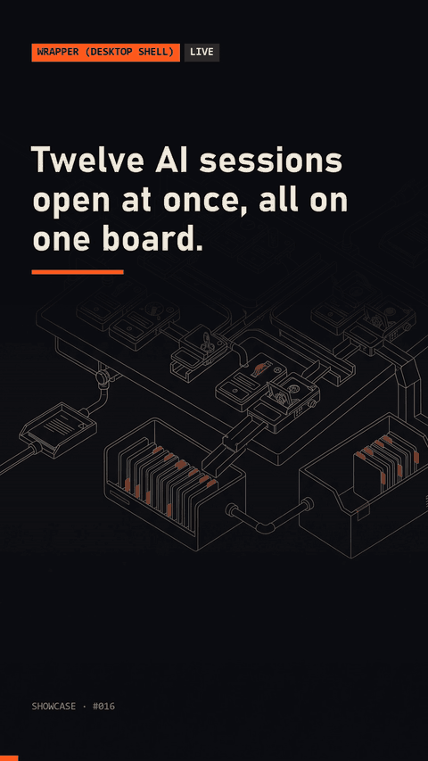

# session-board

A session board for many concurrent Claude Code sessions: each session rendered as a card with name, current step and state (working, waiting for input, done), auto-grouped by project and lane, with a searchable history of closed sessions.



This repo is the portable core of the idea: it reads the session transcripts and renders the board as text or a static page. It is not the desktop shell.

## Quick start

```
python demo.py
```

Uses sample sessions in `tests/fixtures`. On your own sessions: `python -m board --html board.html` (reads `~/.claude/projects`; add `--search text` to search history). Tests: `python -m unittest discover -s tests`.

## Requirements

Python 3.8+. No dependencies. Read-only: it never writes to your transcripts.

## How it works

- Each `<project-folder>/<session>.jsonl` transcript becomes one card. The name is the first prompt, the project comes from the session's working folder.
- State comes from the last event: an assistant message with a tool call is "working", an assistant message with only text is "waiting" for you, and a session idle longer than `BOARD_DONE_AFTER_MIN` (default 30) is "done".
- Cards are grouped by project. `--search` filters name, project and last step, which also searches closed sessions.
- The HTML page escapes all text and refreshes itself every 5 seconds.
- Malformed lines in a transcript are skipped.

## Results

Measured from the author's own use, numbers only, no session content. The session folder holds 1,835 transcripts across 35 project folders. First events run from 25 Aug to 25 Oct 2026.

- Busiest day: 98 sessions started on 23 Oct 2026. 50 started on 25 Oct, a partial day.
- Per-session summaries saved on context compaction, 13 Sep to 25 Oct 2026: 3,099 files from 444 distinct sessions.
- Not measured: how many cards were working, waiting or done over time. The board computes that live and keeps no history of it.

## License

MIT. See [LICENSE](LICENSE).

Built with Claude Code. More: https://made-by-asking.pages.dev/showcase/session-board/
